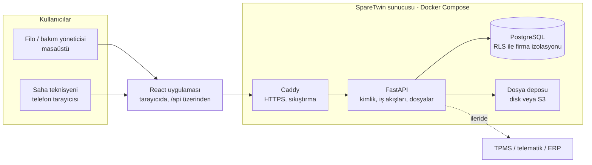

# Mimari

## Genel bakış



Aynı paket iki şekilde çalışır:

| Mod | Nerede | Firma sayısı | Kim yönetir | Faz |
|---|---|---|---|---|
| `cloud` | Bizim VPS'imiz (AB bölgesi) | Çok (SaaS) | Biz | Şimdi |
| `onprem` | Müşterinin sunucusu | Tek | Müşteri, bizim betiklerimizle | Faz 3 sonrası |

Kod aynı, fark `DEPLOYMENT_MODE` ve birkaç ayarda. Bu yüzden bugünden şu kurallara uyuyoruz: dış servise zorunlu bağımlılık yok, her şey Docker imajında, migrasyonlar imajın içinde ve açılışta otomatik uygulanıyor, dosya deposu değiştirilebilir.

## Arayüz ile API arasındaki bağlantı

Tarayıcı her zaman tek bir adresle konuşur; API istekleri `/api` ile başlar:

| Ortam | Kim aktarır | Nasıl |
|---|---|---|
| Geliştirme (Codespace) | Vite geliştirme sunucusu (5173) | `/api/*` → `http://127.0.0.1:8000/*` |
| Canlı / müşteri sunucusu | Caddy | `/api/*` → API container'ı, diğer her şey → `frontend/dist` |

Bu sayede CORS ayarı gerekmez, API portu dışarı açılmaz ve dosya/etiket linkleri (`PUBLIC_BASE_URL=/api`) her ortamda aynı çalışır.

## Katmanlar ve sorumluluklar

| Katman | Teknoloji | Ne yapar | Ne yapmaz |
|---|---|---|---|
| Arayüz | React + TypeScript (Vite) | Ekranlar, formlar, grafikler, mobil uyumlu saha formu | İş kuralı içermez, hesap yapmaz |
| API | FastAPI | Kimlik doğrulama, firma bağlamı, girdi doğrulama, dosya yükleme, Türkçe hata mesajları | İş kuralını tekrar yazmaz; veritabanı fonksiyonunu çağırır |
| İş kuralları | PostgreSQL fonksiyonları | Takma/sökme, sayaç, inspeksiyon kalite kapıları, saat ve sağlık hesapları | |
| Güvenlik (son halka) | PostgreSQL RLS | Kullanıcı yalnızca kendi firmasının verisini görür | API'ye güvenmez |
| Dosyalar | Disk veya S3 uyumlu depo | Fotoğraf, sertifika, PDF | Herkese açık link yok; API kısa ömürlü imzalı link verir |
| HTTPS | Caddy | Sertifika alma/yenileme, güvenlik başlıkları | |

### Neden iş kuralları veritabanında?

Aynı kural (örneğin "takılı parçanın saati nasıl hesaplanır") tek yerde yazılır. API, ileride gelecek mobil uygulama, TPMS entegrasyonu veya müşterinin kendi ERP'si aynı fonksiyonu çağırır. API katmanı ince kalır: kim, hangi firma adına, hangi yetkiyle soruyor ve girdi geçerli mi?

## İstek akışı ve firma izolasyonu

```mermaid
sequenceDiagram
  participant W as React
  participant A as FastAPI
  participant D as PostgreSQL
  W->>A: GET /assets<br/>Authorization: Bearer ...<br/>X-Tenant-Id (çok firmalıysa)
  A->>A: JWT doğrula, kullanıcı aktif mi?
  A->>D: BEGIN; SET LOCAL ROLE sparetwin_app;<br/>set_config('app.user_id', kullanıcı)
  A->>D: select ... from v_asset_health where tenant_id = ...
  D->>D: RLS: yalnızca üyesi olunan firmanın satırları
  D-->>A: satırlar
  A-->>W: JSON
```

Güvenlik iki katmanlı:

1. **API** her sorguda `tenant_id` filtresi kullanır ve kaydın firmaya ait olduğunu kontrol eder (yoksa 404).
2. **PostgreSQL**, API bir yerde filtreyi unutsa bile başka firmanın satırını döndürmez. Her istek kısıtlı `sparetwin_app` rolüne geçer; bu rol tabloların sahibi değildir, RLS'e tabidir.

Testler ikisini de ayrı ayrı doğrular (`backend/tests/test_isolation.py`): API üzerinden erişim denemeleri ve doğrudan veritabanında "filtre unutulmuş" sorgular.

Ek korumalar:

- `sparetwin_app` rolü parola özetlerini (`app_users.password_hash`) ve token tablosunu okuyamaz. Giriş, dar yetkili `SECURITY DEFINER` fonksiyonlardan geçer.
- Yaşam döngüsü defteri (`part_events`) API rolü için yalnızca ekleme ve okumaya açık; geçmiş değiştirilemez.
- Canlıda API, süper kullanıcıyla değil, yalnızca kendi veritabanının sahibi olan bir kullanıcıyla bağlanır (`deploy/postgres-init`).

## Kimlik doğrulama

| Konu | Yaklaşım |
|---|---|
| Parola | argon2id; en az 10 karakter |
| Erişim token'ı | JWT (HS256), 30 dakika, `Authorization: Bearer` başlığında |
| Yenileme token'ı | 30 gün, rastgele; veritabanında yalnızca SHA-256 özeti. Her kullanımda yenisi verilir |
| Çalınma tespiti | Kullanılmış bir yenileme token'ı tekrar gelirse kullanıcının tüm oturumları kapanır |
| Parola değişikliği | Tüm açık oturumları kapatır |
| Hatalı giriş | E-posta yoksa da aynı mesaj ve aynı süre (e-posta tahmini engellenir) |
| Roller | owner > admin > manager > technician > viewer; firma bazlı (`memberships`) |

Faz 3'te eklenecek: giriş denemesi sınırı (rate limit), e-posta ile parola sıfırlama, davet akışı, kurumsal müşteri için SSO (OIDC).

## Dosyalar

- Yükleme API'den geçer: boyut sınırı (15 MB), dosya türü uzantıdan değil **içerikten** tespit edilir (JPEG, PNG, WEBP, HEIC, PDF).
- Anahtar yapısı: `{tenant_id}/inspection/{inspection_id}/{rastgele}.jpg`.
- Okuma: `GET /media/{id}/url` → birkaç dakika geçerli imzalı link. Doğrudan `` içinde kullanılabilir.
- `STORAGE_BACKEND=local`: sunucu diski (Docker volume), yedeğe dahil. Bulutta başlangıç ve müşteri sunucusu için.
- `STORAGE_BACKEND=s3`: S3 uyumlu herhangi bir depo (Hetzner Object Storage, AWS S3, Cloudflare R2...). Fotoğraf hacmi büyüyünce.

## Veri güvenliği ve sahipliği

| Konu | Yaklaşım |
|---|---|
| Barındırma | AB bölgesinde VPS (ör. Almanya) |
| Veritabanı erişimi | Dışarıya kapalı; yalnızca API container'ı erişir |
| Yedekleme | Günlük `pg_dump` + dosyalar, 14 gün saklama, sunucu dışına kopya (`deploy/backup.sh`) |
| Veri dışa aktarma | Her firma tüm verisini CSV/JSON alabilir (Faz 3) |
| Müşteri sunucusu | Aynı compose paketi; veri hiç dışarı çıkmaz (Faz 3 sonrası) |
| KVKK | Kişisel veri az (ad, e-posta). Aydınlatma metni ve veri işleme sözleşmesi Faz 3'te; hukuki kontrol bir avukatla yapılmalı |
| 3D tasarım dosyaları | ERP fazında bile yüklenmez, yalnızca BOM metadata'sı |

## Ortamlar

| Ortam | Nerede | Amaç |
|---|---|---|
| Yerel | Codespace (`make api`) | Geliştirme ve test, demo veri |
| Geliştirme sunucusu | Küçük VPS, `deploy/` paketi | Ekiple paylaşılan kalıcı test ortamı (sonra) |
| Canlı | Ayrı VPS, `deploy/` paketi | Pilot müşteriler (Faz 1 sonu) |

Kural: Şema değişikliği her zaman yeni bir `db/migrations/000N_...sql` dosyasıdır. Uygulanmış bir migrasyon düzenlenmez; çalıştırıcı bunu fark edip uyarır.

## Müşteri sunucusuna kurulum (Faz 3 sonrası)

Bugünden hazır olanlar: tek komutla kalkan compose paketi, imaj içinde migrasyonlar, açılışta otomatik şema güncellemesi, yerel dosya deposu, internetsiz çalışabilen yapı.

Faz 3'te eklenecekler:

- Frontend derlemesini (`frontend/dist`) aynı sunucudan sunma (Caddyfile'da hazır şablon); statik dosya olduğu için internetsiz ağda da çalışır.
- İç ağda HTTPS: telefon tarayıcısı kamera ve QR okumayı yalnızca güvenli bağlantıda açar. Müşterinin alan adı ve sertifikası ya da kurulum betiğinin ürettiği iç sertifika.
- İnternetsiz çalışan imzalı lisans dosyası.
- Tek komutla güncelleme ve tanılama paketi (log toplama).
- Saha erişimi planı: saha Wi-Fi, VPN veya müşterinin sunucuyu dışarı açması; her müşteride ayrı konuşulur.

## Ölçeklenme notu

Faz 1–3 için tek PostgreSQL ve 2 API işçisi yeterli: müşteri başına yüzlerce makine, binlerce parça, on binlerce ölçüm. Yük artınca önce API işçi sayısı ve sunucu boyutu büyütülür. TPMS gibi sensör verisi geldiğinde (Faz 5) ölçümler saniyelik akar; o noktada `measurements` tablosu bölümlenir veya ham sensör verisi ayrı tutulup yalnızca özetler yazılır.
