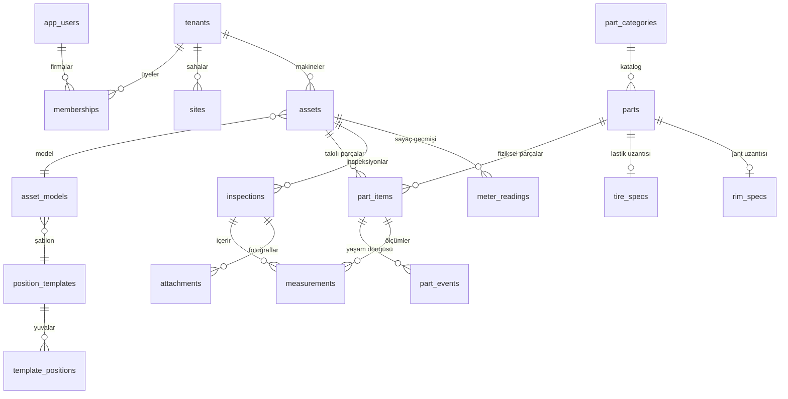

# Veri modeli: dijital parça ikizi

## Ana fikir

Platformun kalbi üç kavram:

1. **Makine** (`assets`): Bir yükleyici, reach stacker, forklift, pres. Motor saati ve kilometresi var.
2. **Pozisyon** (`template_positions`): Makine modelinde bir parçanın takılabileceği yuva. "Ön aks sol", "Kaldırma silindiri sağ", "Akü". Her pozisyon hangi kategoriden parça kabul ettiğini bilir.
3. **Parça ikizi** (`part_items`): Seri numaralı, QR etiketli tek bir fiziksel parça. Bir pozisyona takılır, sökülür, tamire gider, kaplanır, başka makineye geçer, hurdaya ayrılır. Her adım `part_events` defterine yazılır.

Lastik bu modelde özel değil: `tire` kategorisinde bir parça. Diş derinliği bir ölçüm, kaplama bir olay. Bu sayede aynı ekranlar ve aynı kurallar hidrolik silindir için de çalışır.



## Tablolar

| Tablo | Ne tutar | Not |
|---|---|---|
| `tenants` | Firma | `settings` içinde para birimi, dil |
| `app_users` | Kullanıcı | Parola özeti API rolüne kapalı |
| `refresh_tokens` | Oturum yenileme token'ları | Yalnızca SHA-256 özeti |
| `memberships` | Kullanıcı–firma–rol | Bir kullanıcı birden çok firmada olabilir |
| `sites` | Saha / depo / fabrika | Maden, liman, şantiye |
| `position_templates`, `template_positions` | Makine tipine göre yuvalar | `x`, `y` dashboard şemasındaki konum (0–100) |
| `asset_models` | Üretici + model + şablon | Volvo L220H → yükleyici şablonu |
| `assets` | Tek makine | `meter_hours` güncel motor saati |
| `meter_readings` | Sayaç geçmişi | Geri gidemez kuralı fonksiyonda |
| `part_categories` | Lastik, jant, silindir, pompa, akü, filtre... | `measurement_profile` ve `required_photo_angles` inspeksiyon kurallarını belirler |
| `parts` | Katalog kalemi (SKU) | `specs.expected_life_hours` lastik dışı parçaların ömrü |
| `part_items` | Fiziksel parça (ikiz) | `hours_accumulated` önceki montajlardaki toplam saat |
| `part_events` | Yaşam döngüsü defteri | Append-only. `part_hours` olay anındaki parça saati |
| `inspections` | Saha kontrolü | `qc_flags` kalite kapısı sonuçları |
| `measurements` | Ölçüm | Esnek: `metric` + `value` + `unit` + `source` |
| `attachments` | Fotoğraf/doküman kaydı | Dosya diskte veya S3'te; inspeksiyonda parça+açı başına bir fotoğraf |
| `tire_specs`, `rim_specs` | TireIQ uzantıları | Orijinal diş derinliği, hurda sınırı, jant NDT periyodu |

## Parça saati nasıl hesaplanır?

Parça kendi motoru olmadığı için saatini takılı olduğu makineden alır:

```
toplam saat = önceki montajlarda biriken saat
            + (makinenin şu anki saati − takıldığı andaki makine saati)   [takılıysa]
```

Söküldüğünde ikinci terim `hours_accumulated`'a eklenir ve sıfırlanır. Parça başka makineye geçince saymaya oradan devam eder. Bu hesap `remove_part_item` fonksiyonunda ve `v_part_items_live` görünümünde tek yerde yapılır; API bu değerleri olduğu gibi döndürür.

## Sağlık skoru

`v_part_health` her parça için 0–100 arası bir **durum yüzdesi** ve bir **bant** üretir:

- **Lastik:** kalan diş = (güncel diş − hurda sınırı) ÷ (orijinal diş − hurda sınırı)
- **Diğer parçalar:** kalan ömür = 1 − (toplam saat ÷ beklenen ömür saati)
- **Bantlar:** %20 altı `critical`, %20–40 `watch`, üstü `ok`, veri yoksa `unknown` (eşikler TireIQ sunumundakiyle aynı)

Lastik için ayrıca doğrusal aşınma modeli (Faz 1):

```
aşınma hızı (mm/saat) = (orijinal diş − güncel diş) ÷ toplam saat
kalan saat           = (güncel diş − hurda sınırı) ÷ aşınma hızı
ömür sonu saat başı maliyet = toplam maliyet ÷ (toplam saat + kalan saat)
```

Bu bilerek basit tutuldu. TireIQ sunumundaki model yol haritası aynen geçerli: veri biriktikçe Random Forest/XGBoost, sonra koşul bazlı (zemin, yük) modeller. Görünümün çıktı kolonları (`projected_hours_left`) ve API yanıtı aynı kalacağı için WeWeb ekranları model değişince etkilenmez.

## İnspeksiyon kalite kapıları

TireIQ sunumundaki 4 kalite kapısı `complete_inspection` fonksiyonunda uygulanır:

| Kapı | Kontrol | Başarısızlıkta |
|---|---|---|
| KK1 Kimlik | Ölçülen parça gerçekten bu makinede takılı mı? | Kayıt reddedilir, parça eşleşmesi düzeltilir |
| KK2 Fotoğraf | Kategorinin zorunlu açıları yüklendi mi? (lastikte taban + yanak) | Form tamamlanmaz |
| KK3 Ölçüm | Zorunlu ölçümler var mı, değerler makul aralıkta mı? | Yeniden ölçüm uyarısı |
| KK4 Sayaç | Motor saati girildi mi, öncekinden geri gitmiyor mu? | Düzeltme istenir |

Hata varsa inspeksiyon `draft` kalır ve `qc_flags` içinde pozisyon pozisyon ne eksik olduğu döner (`POST /inspections/{id}/complete` yanıtı). WeWeb formu bu listeyi doğrudan saha teknisyenine gösterir. Teknisyen ölçümü düzeltip tekrar gönderdiğinde aynı parça+ölçüm güncellenir, kopya oluşmaz.

## Yeni bir parça tipi eklemek

Örnek: forkliftlerde zincir uzamasını izlemek istiyoruz.

1. Yeni bir migrasyon dosyasında kategori ekle: `insert into part_categories (tenant_id, code, name, measurement_profile) values (null, 'chain', 'Zincir', '[{"metric":"elongation_pct","label":"Uzama","unit":"%","required":true,"min":0,"max":10}]');`
2. Forklift şablonuna pozisyon ekle: `MAST-CHAIN-L`, `MAST-CHAIN-R`, kategori `chain`.
3. Katalogda zincir parçasını `expected_life_hours` ile tanımla.

Kod değişikliği yok. Dashboard şeması yeni pozisyonu `x/y` değerinden çizer, inspeksiyon formu ölçüm alanını profilden üretir, sağlık skoru ömürden hesaplanır. Daha zengin kurallar gerekirse (lastikteki gibi) bir uzantı tablosu ve görünüm eklenir.

## ERP fazında ne eklenecek?

Faz 2 ve Faz 4'te bu modelin önüne tedarik ve üretim tarafı bağlanır. Taslak:

| Faz | Tablolar | Bağlantı noktası |
|---|---|---|
| 2 | `warehouses`, `stock_movements`, `suppliers`, `purchase_requests`, `purchase_orders`, `maintenance_plans`, `work_orders` (bakım) | `parts.min_stock`, `part_items.status = in_stock` |
| 4 | `boms`, `bom_lines`, `routings`, `production_orders`, `scrap_records` | `parts` aynı katalog; üretilen makine `assets` olarak doğar |

Böylece bir makine imalatçısı ürettiği makineyi müşteriye teslim ettiğinde, o makinenin parça ikizleri hazır olarak müşteri tarafına geçebilir. Bu, uzun vadede ürünün en güçlü farklılaştırıcısı olabilir.
