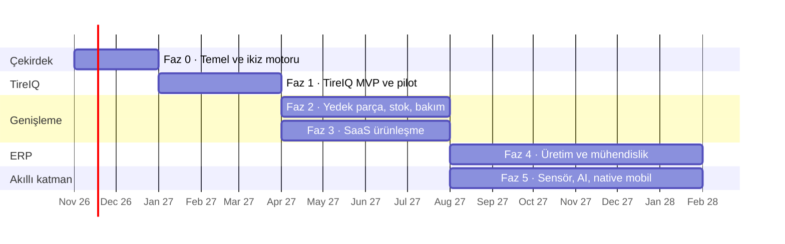

# Yol haritası

## Sıralama mantığı

1. **Önce dar ve derin.** TireIQ tek bir parça tipiyle başlar ama genel ikiz motorunun üzerine kurulur. Satış kolay (lastik maliyeti herkesin derdi), geliştirme odaklı kalır.
2. **Sonra genişle.** Aynı motor, kod değişmeden her yedek parçaya açılır; stok, satınalma ve bakım eklenir. Bu noktada ürün "lastik programı" olmaktan çıkıp "parça yönetim platformu" olur.
3. **En son üretim.** KOBİ ERP'nin üretim ve mühendislik tarafı (BOM, iş emri, MRP) en büyük ve en firmaya özel iş. Ancak çekirdek oturduktan ve ilk gelir geldikten sonra başlanır.
4. **Mobil ve yapay zekâ veriye bağlı.** Native uygulama ve ömür tahmini modeli, sahada gerçek kullanım ve yeterli ölçüm biriktikten sonra anlam kazanır.

Süreler 1–2 kişilik bir geliştirme ekibi için kaba tahmindir; her faz pilot geri bildirimine göre netleşir. Faz 2 ve Faz 3 paralel yürüyebilir.

---

## Faz 0 · Temel ve ikiz motoru

**Hedef:** Bir makineyi ve parçalarını sisteme girip, QR okutunca parçanın tüm geçmişini görmek.

| Kapsam | Durum |
|---|---|
| Çok kiracılı şema, roller, RLS | ✅ Hazır (`db/migrations/0001`, `0002`) |
| Parça ikizi iş kuralları: takma, sökme, sayaç, olay defteri, kalite kapıları | ✅ Hazır (`0003`) |
| TireIQ uzantıları ve ortak kütüphane (3 makine şablonu, 6 kategori) | ✅ Hazır (`0004`, düzeltme `0007`) |
| Kendi kimlik sistemimiz: argon2 parola, JWT, dönen yenileme token'ı | ✅ Hazır (`0005`) |
| FastAPI: filo, makine, parça, yaşam döngüsü, inspeksiyon, fotoğraf, QR | ✅ Hazır |
| Kayıt: saha, makine modeli, katalog (lastik/jant bilgisiyle), makine, parça teslim alma | ✅ Hazır (`0006`) |
| QR kodu otomatik atama ve A4 etiket yazdırma sayfası | ✅ Hazır (API tarafı) |
| 43 otomatik test | ✅ Hazır |
| Codespace ortamı (Python 3.12 + PostgreSQL), GitHub | ✅ Hazır |
| Dashboard görsel prototipi | ✅ Hazır (`prototype/`) |
| React frontend: giriş, oturum yenileme, firma seçimi, rol bazlı menü | ✅ Hazır (`frontend/`) |
| Filo dashboard'u: filo şeridi, makine şeması, parça ikizi, aşınma grafiği, öncelikli işler, maliyet | ✅ Hazır |
| Makine ve parça sayfaları: takma, sökme, motor saati, olay kaydı | ✅ Hazır |
| Kayıt formları, parça listesi, QR etiket yazdırma, QR/seri no arama | ✅ Hazır |
| Frontend testleri (8) ve 10 adımlık uçtan uca tarayıcı senaryosu | ✅ Hazır |
| Senin Codespace'inde doğrulama (`make dev`) | ⏳ Sırada |

**Sonraya ertelendi (sunucu ve alan adı işleriyle birlikte):** geliştirme/canlı sunucu, alan adı, hata izleme ve uptime kontrolü. Faz 0 boyunca her şey Codespace'te çalışır.

**Bitiş kriteri:** Arayüzden yeni bir makine ve lastikleri girilip QR etiketleri yazdırılabiliyor; demo filo dashboard'da görünüyor; bir lastik sökülüp yenisi takıldığında dashboard anında doğru sonucu gösteriyor.

**Kapsam dışı:** Mobil form, rapor, faturalama.

---

## Faz 1 · TireIQ MVP ve pilot

**Hedef:** İlk pilot filo (liman veya maden) lastiklerini ve jantlarını gerçek sahada SpareTwin ile izliyor.

| Kapsam | Not |
|---|---|
| ✅ **Görseller** | Katalog kalemi, makine modeli ve makine görseli; parça ikizinde saha fotoğrafları ve büyütme penceresi. Yüklenen her görselde yön düzeltme, 1600 px'e küçültme ve GPS/meta veri silme |
| ✅ **Mobil kontrol formu** (`/kontrol`) | Kamerayla QR okutma (Android ve iPhone), motor saati, pozisyon kartları, önceki ölçüm ipucu ve anlık aralık uyarısı, zorunlu fotoğraf yuvaları, "kaydet, sonraki", yarım kalan kontrole devam, 4 kalite kapısı, iptal |
| ✅ Fotoğraf yükleme, sıkıştırma, zorunlu açılar | Telefonda 1600 px'e küçültülür, sunucuda GPS silinir |
| ✅ Ölçümler yalnızca tamamlanan kontrolden sayılır | Taslak veya iptal edilmiş kontroldeki değer dashboard'u etkilemez (`0009`) |
| ✅ Lastik ve jant yaşam döngüsü ekranları | Takma (lastik jantıyla birlikte, tek işlem), sökme (stoğa / tamire / kaplamaya / hurdaya), tek adımda rotasyon (doluysa yer değiştirir, saatler korunur), tamir, kaplamadan dönüş, NDT kaydı |
| ✅ **Jant uyumluluğu** (`/jantlar`) | Her lastik pozisyonunun jant pozisyonu (`A1-L-J`), gecikmiş / yaklaşan / güncel listesi, tek tıkla "muayene yapıldı" kaydı (`0010`) |
| ✅ Doğrusal aşınma ve kalan saat tahmini | `v_tire_health`; parça ikizinde grafik |
| ✅ Saat başı maliyet | Bugüne kadar (parça ikizi) ve ömür sonu beklenen (dashboard, rapor) |
| ✅ **Toplu içe aktarma (Excel/CSV)** | Şablon indirme, esnek sütun başlıkları, Türkçe sayı/tarih, önizleme (satır satır hata ve uyarı), ya hepsi ya hiçbiri, yeni makine ve katalog kalemi oluşturma, yeni lastiklerin etiketlerini yazdırma |
| ✅ **PDF durum raporu** | Tüm filo veya tek makine: yönetici özeti, makineler, öncelikli işler, saat başı maliyet, jant muayenesi, stok uyarıları, tamamlanmış kontrollerin saha fotoğrafları. Türkçe karakterler için Barlow gömülü |
| ✅ **Uygulama içi bildirimler** | Üst çubukta zil: kritik parça, jant muayenesi, düşük stok, 30 gündür kontrol edilmeyen makine. Kişiye özel okundu bilgisi; durum değişince yeniden okunmamış olur. E-posta, sunucu aşamasında aynı listeye bağlanacak |
| 🟡 Sökme sebep kodları | ✅ Sabit liste: aşınma, kesik, darbe, ayrışma, basınç kaybı, sızıntı, rotasyon, diğer. ⏳ Firmanın kendi sebeplerini ekleyebilmesi ve sebep bazlı rapor |

| ✅ Excel'de jant sütunları | Jant seri no, ebat, NDT periyodu; stoktaki jant takılır, yoksa oluşturulur |
| ✅ "Jant kaydı yok" bildirimi | Lastiği takılı ama jantı kaydedilmemiş pozisyonlar: muayene takibi yapılamadığı uyarısı |
| ✅ **Firma eşikleri** (`/ayarlar`, v1.2) | Kritik ve izleme yüzdesi, jant "yaklaşıyor" yüzdesi, kontrol aralığı (gün) firma başına ayarlanır; dashboard, bildirim ve rapor aynı eşiği kullanır (`0013`). Eski TireIQ taslağından devralındı (K-014) |
| ✅ **Bildirimde ekip durumu** (v1.2) | "Üstlen" (biri ilgileniyor, kim/ne zaman) ve "gizle" (durum değişene kadar). Durum kötüleşince kayıt kendiliğinden düşer, sorun geçince kapanır |

**Faz 1 yazılımı tamamlandı (v1.0).** Kalan tek kalem sökme sebeplerinin firmaya özel düzenlenmesi; Faz 3'teki ayarlar ekranına taşındı.

**Pilot için gerekenler (yazılım dışı ve sunucu):** Sunucu ve alan adı, gerçek kullanıcı hesapları ve parola sıfırlama, e-posta bildirimleri, yedekleme. Bunlar Faz 3'teki "SaaS ürünleşme" maddeleriyle örtüşüyor; pilot öncesinde asgari kısmı öne çekilecek.

**Pilot programı:** 2–3 firma, ücretsiz veya indirimli. İlk envanter girişini biz yapıyoruz (enTIRE "Bureau" modeli). Karşılığında aylık geri bildirim görüşmesi ve referans izni.

**Bitiş kriteri:** En az 1 filoda 100+ tamamlanmış inspeksiyon, saha ekibi formu yardımsız kullanıyor, yönetici aylık raporu kendisi açıyor.

---

## Faz 2 · Her makine için yedek parça: stok, satınalma, bakım

**Hedef:** Lastik dışındaki kritik parçalar da ikizle izleniyor; "ne zaman değişecek" sorusu "stokta var mı, ne zaman sipariş vermeliyim" sorusuna bağlanıyor.

| Kapsam | Not |
|---|---|
| Kategori ve ölçüm profili yönetim ekranı | Firma kendi parça tiplerini tanımlar |
| Pozisyon şablonu düzenleyici | Firma kendi makine tipini çizer (sürükle-bırak x/y) |
| ✅ **Depo ve stok hareketleri** (`/stok`) | Sarf malzemeleri (filtre, yağ, keçe) adet/litre/takım ile: giriş, makineye çıkış, sayım düzeltmesi, depolar arası transfer. Seviye hareketlerden hesaplanır, defter değiştirilemez, eksi stok yok, ağırlıklı ortalama maliyet. Seri numaralı stok aynı ekranda (`0012`) |
| ✅ **Kritik stok uyarısı ve yaklaşan değişime göre ihtiyaç** | Kritik seviye uyarısı (bildirim, dashboard, rapor) sarf dahil. "LD-07 için 2 lastik yaklaşıyor, stokta 1 var" önerisi `v_purchase_needs` ile: kritik ya da firmanın *değişim ufku* (varsayılan 500 saat) içinde ömrü biten takılı parçalar + kritik seviye − stok − siparişte. Bildirimde, dashboard'un öncelikli işlerinde ve Satınalma › İhtiyaç'ta; tek tıkla talebe dönüşür |
| ✅ **Tedarikçi, satınalma talebi, sipariş, teslim alma** (`/satinalma`) | KOBİ ERP planındaki satınalma modülünün sade hali (`0014`): talep (teknisyen) → sipariş (yönetici, tedarikçi şart) → kısmi / tam teslim (teknisyen); iptal yalnızca teslimat başlamadan. Teslim alma stokla aynı kapıdan geçer: sarf kalemi `stock_move('in')` ile sipariş no + irsaliye referansıyla, seri numaralı parça `part_items` + `received` olayıyla. Geciken sipariş bildirimi. ⏳ Fiyat teklifi karşılaştırma, tedarikçi performansı |
| Bakım planları | Saat veya takvim bazlı periyodik bakım |
| Arıza ve duruş kaydı | Duruş süresi, sebep, ilgili parça |
| Makine toplam sahip olma maliyeti | Parça + bakım + duruş |

**Bitiş kriteri:** Pilot firmalardan biri en az bir lastik dışı parça grubunu (hidrolik, akü veya zincir) aktif izliyor ve stok uyarısıyla en az bir sipariş açılmış.

---

## Faz 3 · SaaS ürünleşme

**Hedef:** Bir firma satış ekibiyle konuşmadan kaydolup, ödeme yapıp kullanmaya başlayabiliyor.

| Kapsam | Not |
|---|---|
| Kendi kendine kayıt ve firma oluşturma | Davet ile ekip ekleme |
| Abonelik ve ödeme | Türkiye için iyzico veya PayTR, yurt dışı için Stripe değerlendirilecek |
| Plan limitleri | TireIQ sunumundaki Starter / Pro / Enterprise yapısı, parça sayısı limiti |
| Onboarding sihirbazı | İlk saha, ilk makine, ilk QR etiketi |
| Raporlar ve dışa aktarma | Tüm veri CSV/JSON, zamanlanmış e-posta raporu |
| 🟡 Denetim kaydı ve rol ayrıntıları | ✅ Denetim kaydı v1.2'de öne çekildi: durum değiştiren her istek kim/ne/ne zaman olarak yazılır, yönetici `/ayarlar`'da görür (`0013`). ⏳ Rol ayrıntıları (özel yetkiler) |
| KVKK metinleri, kullanım koşulları, veri işleme sözleşmesi | Hukuki kontrol gerekli |
| PWA | Ana ekrana ekleme, zayıf internette çalışma (çevrimdışı kuyruk) |
| Giriş güvenliği | Deneme sınırı, e-posta ile parola sıfırlama, davet akışı |
| **Müşteri sunucusu kurulum paketi** | Frontend derlemesi aynı sunucuda, iç ağ HTTPS, imzalı lisans dosyası, tek komutla güncelleme, tanılama paketi |
| Çoklu dil | Türkçe + İngilizce (ihracat pazarı) |

**Bitiş kriteri:** İlk 5 ödeme yapan müşteri (TireIQ sunumundaki hedef) ve en az bir müşteri sunucusuna deneme kurulumu.

---

## Faz 4 · Üretim ve mühendislik (KOBİ ERP)

**Hedef:** Makine imalatı yapan KOBİ, ürettiği makinenin BOM'unu, iş emirlerini ve gerçek maliyetini SpareTwin'de yönetiyor.

KOBİ ERP yol haritasındaki Faz 1–3 burada, parça kataloğunu ortak kullanarak gelir:

| Kapsam | Not |
|---|---|
| BOM içe aktarma (Excel/CSV) | 3D dosya yok, yalnızca metadata |
| eBOM → mBOM kural motoru | Firmaya özel kurallar; ilk müşteriyle birlikte tasarlanır |
| İş emri, rota, proses süresi | Başla/durdur zaman kaydı, proses bazlı raporlama |
| Üretilebilirlik (available-to-build) ve tedarik açığı (MRP) | "Ne üretelim, ne alalım" |
| Fire / hurda takibi | Plan vs gerçek, sebep sınıflandırma |
| Üretim maliyeti | Malzeme + işçilik + makine saati |
| Teslim edilen makinenin ikizini müşteriye devretme | Üreticiden filoya parça geçmişi aktarımı |
| Mühendislik hesap araçları | Büküm payı, hidrolik silindir kuvveti/debisi; "ön kontrol" uyarısıyla |

**Ön koşul:** En az bir makine imalatçısı pilot ve örnek BOM seti.

---

## Faz 5 · Akıllı katman ve mobil

| Kapsam | Ön koşul |
|---|---|
| TPMS entegrasyonu (basınç, sıcaklık) | Açık API'li sensör üreticisiyle başla; ölçüm tablosu bölümlenir |
| Telematik ile otomatik motor saati | Makine üreticisi API'leri veya CAN-bus ağ geçidi |
| Yapay zekâ ile ömür tahmini | 1.000+ tamamlanmış lastik ömrü verisi; TireIQ sunumundaki model merdiveni |
| Native mobil uygulama | PWA'nın yetmediği net bir ihtiyaç (RFID okuma, tam çevrimdışı) |
| SolidWorks eklentisi | Faz 4'te CSV akışı oturmuş olmalı |
| Tedarikçi portalı | Lastik bayisi/servisin doğrudan kayıt girmesi (enTIRE SupplierNet benzeri) |

---

## Riskler

| Risk | Olasılık | Önlem |
|---|---|---|
| Saha ekibi veri girmiyor | Yüksek | Formda en az alan, QR ile 3 saniyede kimlik, ilk girişi biz yapıyoruz, yöneticiye "kim girmedi" değil "hangi makine eksik" raporu |
| Ekran değişiklikleri kod gerektirir (görsel editör yok) | Orta | Bileşenler küçük ve tek tasarım diliyle; kurallar veritabanında olduğu için arayüz ince kalır |
| Kendi backend'imizin işletme yükü (güncelleme, yedek, güvenlik yaması) | Orta | Docker ile tekrarlanabilir kurulum, otomatik yedek, testli migrasyonlar; Faz 1'de izleme |
| Çok sayıda müşteri sunucusunu güncel tutmak | Orta (Faz 3+) | Sürümlü imajlar, açılışta otomatik migrasyon, tek komutla güncelleme |
| Kapsam şişmesi (her şey ERP olsun) | Yüksek | Faz bitiş kriterleri net; Faz 4 ancak Faz 3 kriteri tutunca başlar |
| Rakip kurumsal çözümler | Orta | KOBİ fiyatı, Türkçe destek, marka bağımsızlık, hızlı kurulum |
| Az veriyle yanlış tahmin güveni | Orta | Doğrusal model + "yetersiz veri" uyarısı, tahmin aralığı gösterimi |
| Tek kişiye bağımlı geliştirme | Orta | Her şey bu repoda, testli, dokümanlı |
